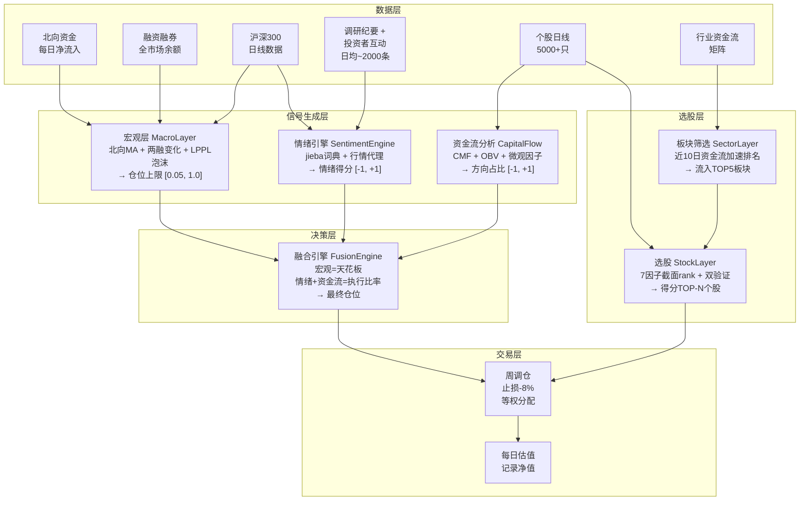
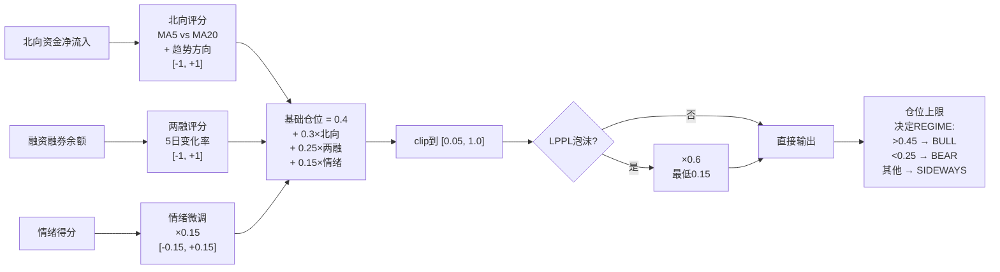
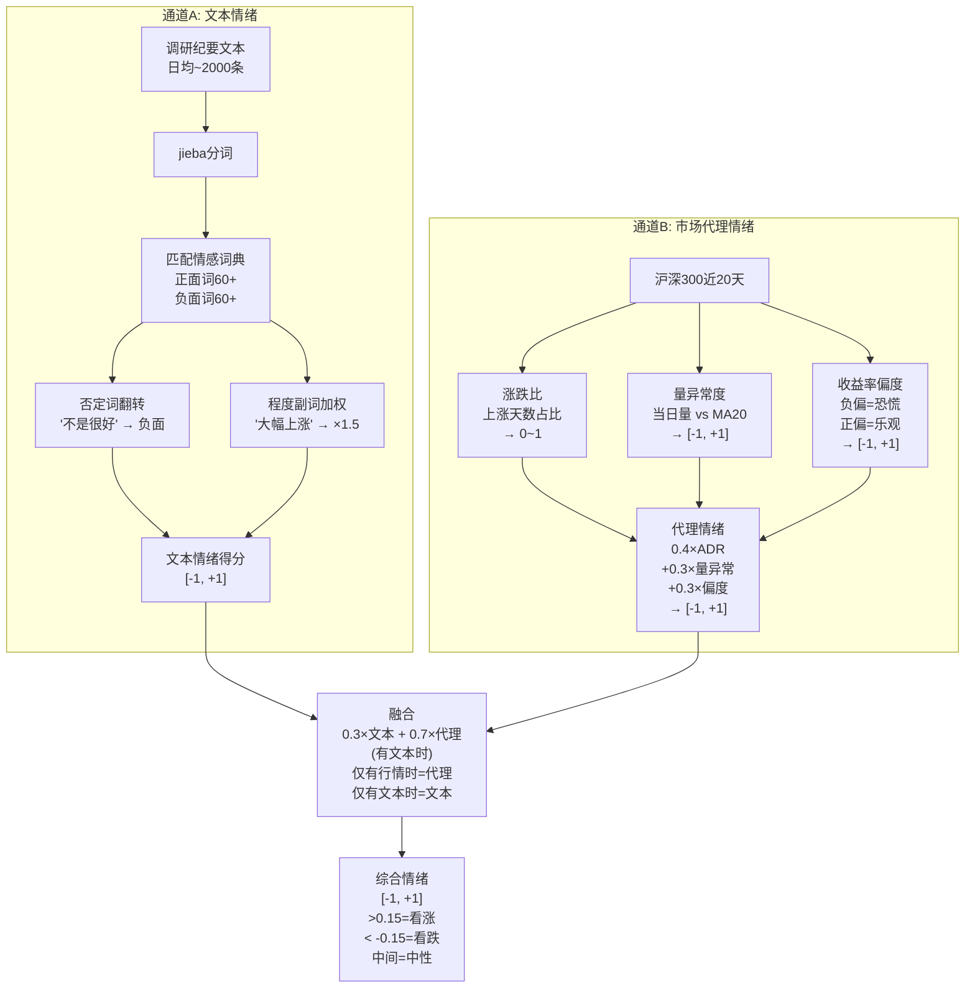
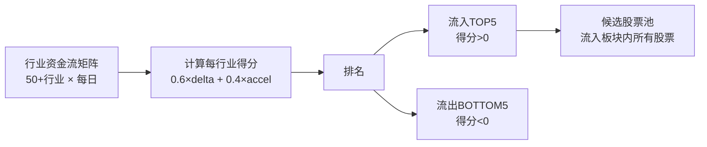
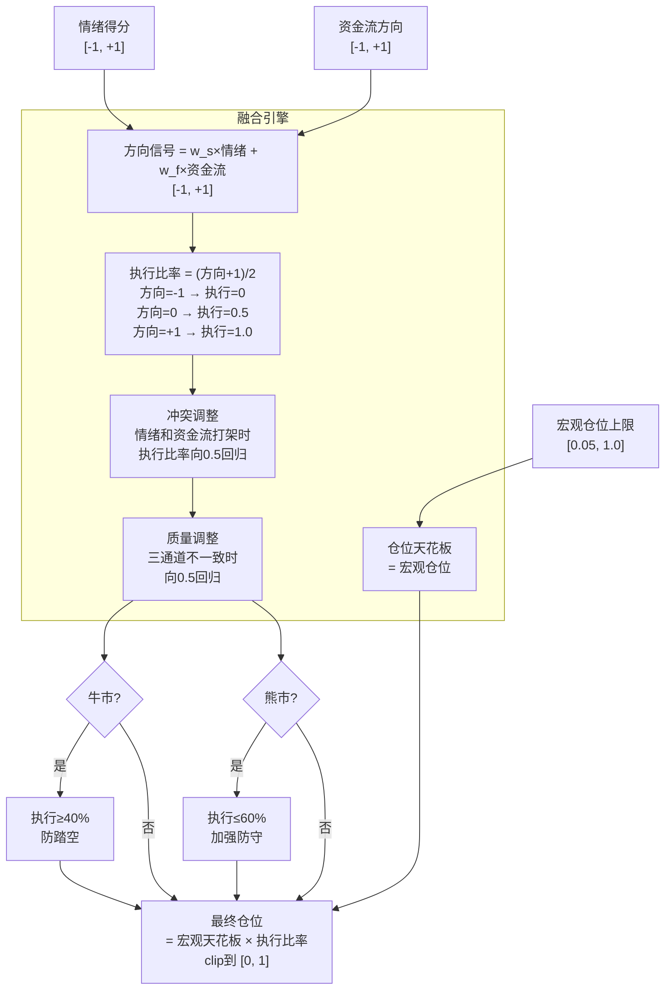
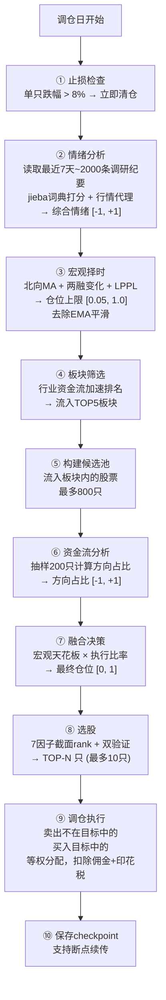

# A股情绪-资金流融合分析系统 —— 完整逻辑说明

> 赌神专用审计版。用文科生能听懂的语言，把每一行代码在干什么说清楚。

---

## 一、一句话概括

这个系统做的事情：**每周自动判断"该不该买、该买多少、该买什么"，然后自动执行，最后看看赚了还是赔了。**

整个流程就像你开车去一个不熟悉的地方：

| 开车类比 | 系统模块 | 干什么 |
|----------|----------|--------|
| 看天气决定出不出门 | 宏观层 (MacroLayer) | 决定仓位上限 |
| 看心情决定开快还是开慢 | 情绪引擎 (SentimentEngine) | 判断市场情绪 |
| 看路况决定走哪条路 | 资金流分析 (CapitalFlow) | 判断资金方向 |
| 导航选路线 | 板块筛选 (SectorLayer) | 选板块 |
| 挑具体哪几条路不堵 | 选股层 (StockLayer) | 选个股 |
| 最终决定出发速度和路线 | 融合引擎 (FusionEngine) | 综合决策 |
| 实际开车，记录油耗和时间 | 回测循环 (main.py) | 模拟交易 |

---

## 二、整体架构图



---

## 三、数据层 —— 系统吃了什么

### 3.1 五大数据源

| 数据 | 来源 | 频率 | 覆盖范围 | 作用 |
|------|------|------|----------|------|
| 沪深300日线 | 掘金下载/本地CSV | 每日 | 2017年起 | 作为基准、计算市场代理情绪 |
| 北向资金 | 掘金下载 | 每日 | 2017年起 | 判断外资态度 |
| 融资融券余额 | 国泰安ZIP (367万行) | 每日 | 2022.06-2026.06 | 判断杠杆资金态度 |
| 调研纪要+投资者互动 | 国泰安CSV (231万条) | 无固定频率 | 2011-2026 | 文本情绪分析 |
| 个股日线 | 掘金下载 (5000+只) | 每日 | 2017年起 | 选股、资金流计算 |
| 行业资金流 | V2策略生成 | 每日 | 2018年起 | 板块筛选 |

### 3.2 调研纪要数据是什么

每条记录是一问一答：

```
问: "公司今年Q3的订单情况怎么样？有没有新的客户？"
答: "公司Q3订单同比增长约15%，新增了3家海外大客户，目前产能饱和度在85%左右..."
```

然后用 jieba 分词 → 匹配正负面词 → 打分。日均约 2,000 条，远优于之前只用 5 条新闻。

---

## 四、信号生成层 —— 三路并行的信息加工

### 4.1 宏观层 (MacroLayer) —— 决定"仓位天花板"

**通俗理解**：就像天气预报。如果天气预报说台风，你就少出门（低仓位）；说晴空万里，你可以多出门（高仓位）。

**三个输入 → 一个输出**：



**核心公式**：

$$\text{仓位上限} = \text{clip}\left(0.4 + 0.3 \times \text{北向} + 0.25 \times \text{两融} + 0.15 \times \text{情绪}, \ 0.05, \ 1.0\right)$$

**几个关键数字的含义**：

| 参数 | 含义 |
|------|------|
| 0.4 | 基础仓位——即使没有信号，默认也有40%的"底仓意愿" |
| 0.3 | 北向的权重——外资态度占30%影响力 |
| 0.25 | 两融的权重——杠杆资金态度占25%影响力 |
| 0.15 | 情绪的微调——市场情绪只起15%的调节作用 |
| 0.05 | 最低仓位——再悲观也不能完全空仓（保留5%最低仓位） |
| 1.0 | 最高仓位——再乐观也不加杠杆 |

**北向评分怎么算的**：

$$\text{背离度} = \frac{MA5 - MA20}{\max(|MA20|, \ 历史均值 \times 0.1, \ 10^{-8})}$$

$$\text{北向评分} = \text{clip}(背离度 \times 3.0 + 趋势 \times 0.3, \ -1, \ 1)$$

- MA5 高于 MA20 → 背离度为正 → 外资近期在加速流入 → 看多
- MA5 低于 MA20 → 背离度为负 → 外资在流出 → 看空

**两融评分怎么算的**：

$$\text{两融评分} = \text{clip}\left(\frac{5日变化率}{5\%}, \ -1, \ 1\right)$$

- 融资余额涨了 5% → 得分 +1.0 → 杠杆资金在加仓
- 融资余额跌了 5% → 得分 -1.0 → 杠杆资金在逃跑

**LPPL 泡沫检测**：

用一个数学模型 (Log-Periodic Power Law) 检查价格是否在"吹泡泡"——涨得太快、形成泡沫。如果检测到泡沫且仓位 > 50%，自动把仓位砍掉 40%（即 ×0.6）。

### 4.2 情绪引擎 (SentimentEngine) —— 判断"市场心情"

**通俗理解**：就像刷朋友圈和微博看看大家今天是开心还是丧。

**双通道融合**：



**关键问题：文本情绪权重只有 0.3**

为什么文本权重这么低？因为词典法的精度有限——"利好"和"利空"这类简单的词频统计，比不上行情数据的行为信号。股价本身就包含了所有市场参与者的综合判断。

### 4.3 资金流分析 (CapitalFlowAnalyzer) —— 判断"钱在往哪流"

**通俗理解**：就像看商场里人流往哪个方向走，人多的地方就是热门。

**不是在算每只股票的"平均分"，而是在算"方向占比"**：

```
抽200只候选股，每只计算资金流得分
→ 统计: 得分 > +0.05 的 = "流入股"
→ 统计: 得分 < -0.05 的 = "流出国"
→ 方向占比 = (流入股数量 - 流出国数量) / 200
→ 结果: [-1, +1]，+1=全部流入，-1=全部流出
```

**每只股票的资金流得分怎么来的**：

综合了多个指标（CMF、OBV、微观结构因子），加权得出一个 [-1, +1] 的得分。具体来说：

| 因子 | 权重 | 含义 | 怎么算 |
|------|:----:|------|--------|
| cmf_turn | 35% | 资金拐头 | CMF短期均值 - CMF长期均值，正=资金回流 |
| vol_20d | 18% | 波动率 | 20日收益标准差 |
| mom_20d | 15% | 动量 | 20日收益率 |
| overnight_ret | 10% | 隔夜收益 | 今日开盘 vs 昨日收盘 |
| vol_rs | 10% | 量比 | 5日均量 / 20日均量 |
| cmf_20 | 7% | CMF值 | 柴金资金流指标 |
| illiq | 5% | 非流动性 | Amihud 非流动性指标 |

**CMF (柴金资金流) 的计算**：

$$\text{MFM} = \frac{(收盘 - 最低) - (最高 - 收盘)}{最高 - 最低}$$

$$\text{CMF} = \frac{\sum_{i=1}^{20} MFM_i \times Volume_i}{\sum_{i=1}^{20} Volume_i}$$

- MFM > 0：收盘价靠近当天最高价 → 资金在主动买入
- MFM < 0：收盘价靠近当天最低价 → 资金在主动卖出
- CMF > 0：过去20天整体资金流入
- CMF < 0：过去20天整体资金流出

---

## 五、选股层 —— 决定"买什么"

### 5.1 板块筛选 (SectorLayer)

**通俗理解**：全国有几十个行业，我不可能每个行业都买。我先看看最近哪些行业"热"——资金在加速流入，就优先去那些行业里挑股票。

**算法**：

1. 每只个行业板块都有一个"资金流评分"（基于行业 CMF 面板）
2. 比较最近4天和前4天：$$\text{得分} = 变化量 \times 0.6 + 加速量 \times 0.4$$
3. 取 TOP5 流入板块 → 只在这些板块里选股



### 5.2 个股选股 (StockLayer)

**通俗理解**：就像招聘。我有一份简历打分表（7个因子），所有候选人（股票）按每个因子排名打分，最后算总分。但还要"面试"——双验证，确保不是"简历漂亮但能力不行"。

**第一步：截面 rank 打分**

```
对所有候选股 (最多800只):
  对每个因子:
    按值排序 → rank分 (0~1)
    乘以因子方向 (+1=越大越好, -1=越小越好)
    乘以权重
  总分 = 所有因子加权分之和
```

**因子方向（默认/熊市/震荡）**：

| 因子 | 方向 | 通俗解释 |
|------|:----:|------|
| cmf_turn | +1 越大越好 | 资金在回流 |
| vol_20d | -1 越小越好 | 波动小说明稳 |
| mom_20d | -1 越小越好 | 前面跌多了该反弹了 |
| overnight_ret | -1 越小越好 | A股高开容易被砸 |
| vol_rs | -1 越小越好 | 缩量说明抛压小 |
| cmf_20 | -1 越小越好 | CMF低说明被低估 |
| illiq | +1 越大越好 | 流动性差说明没人卖 |

**牛市因子方向（全反转！）**：

| 因子 | 方向 | 通俗解释 |
|------|:----:|------|
| 所有因子 | **全部 +1** | 牛市中追涨杀跌才是对的！ |

**第二步：双验证面试**

选出来的高分股票必须至少满足一条：

1. **价格在均线之上** (close > MA20) — 技术面不难看
2. **CMF > 0** — 资金确实在流入

两条都不满足的 → 淘汰。如果全淘汰了 → 放宽到不做双验证，纯按分数选。

**第三步：行业集中度控制**

每个行业最多持有 **3 只**，最多总共持有 **10 只**。

---

## 六、融合决策层 —— 这是整个系统的大脑

### 6.1 核心逻辑（v2 架构）

**最重要的公式，一句话**：

$$\text{最终仓位} = \text{宏观天花板} \times \text{情绪+资金流的执行比率}$$

就像开车：宏观告诉你**最多能开多快**（速度上限），情绪+资金流告诉你**实际踩多少油门**。



### 6.2 权重因市场状态切换

系统根据 **宏观仓位** 判断当前是什么行情，然后切换策略：

| 市场状态 | 判定条件 | 情绪权重 | 资金流权重 | 策略含义 |
|----------|:--------:|:--------:|:--------:|------|
| BULL (牛市) | 宏观 > 0.45 | 30% | **70%** | 趋势中资金流主导，追资金 |
| SIDEWAYS (震荡) | 0.25~0.45 | 50% | 50% | 震荡中等权，左右看 |
| BEAR (熊市) | 宏观 < 0.25 | **60%** | 40% | 防守时情绪更敏感，防下跌 |
| EXTREME (极端) | 情绪 \|>0.7 | **70%** | 30% | 极端情绪主导，仓位封顶50% |

### 6.3 数值举例

**假设某天**：
- 宏观仓位 = 0.50（认为是震荡偏牛市）
- 情绪 = +0.20（轻微看多）
- 资金流 = +0.30（资金在流入）

**计算过程**：

```
1. 市场状态判定: 宏观0.50 → SIDEWAYS
2. 权重: w_s=0.5, w_f=0.5
3. 方向信号 = 0.5×0.20 + 0.5×0.30 = 0.25
4. 执行比率 = (0.25 + 1) / 2 = 0.625
5. 最终仓位 = 0.50 × 0.625 = 0.3125 → 31.25%
```

**假设熊市某天**：
- 宏观仓位 = 0.20（熊市，仓位上限只有20%）
- 情绪 = +0.10（轻微看多）
- 资金流 = -0.15（资金流出）

```
1. 市场状态: BEAR
2. 权重: w_s=0.6, w_f=0.4
3. 方向 = 0.6×0.10 + 0.4×(-0.15) = 0.06 - 0.06 = 0.0
4. 执行 = (0+1)/2 = 0.5
5. 熊市上限: min(0.5, 0.6) = 0.5
6. 最终仓位 = 0.20 × 0.5 = 0.10 → 10%
```

熊市里，即使情绪还行，但因为资金流在流出、宏观限制只有20%仓位，最终只开10%——非常保守。

---

## 七、交易执行层 —— 实际怎么买卖

### 7.1 调仓节奏


- **每周一** 调仓（第一个交易日）
- 每天根据收盘价记录净值
- 初始资金：1000 万

### 7.2 调仓日做了什么（完整流水线）



### 7.3 交易成本

| 费用 | 比率 | 何时扣 |
|------|:----:|------|
| 佣金 | 0.05% | 买入和卖出都扣 |
| 印花税 | 0.1% | 仅卖出时扣 |

### 7.4 止损机制

每只持仓股记录买入时的平均成本。调仓日检查：

$$\text{跌幅} = \frac{\text{当前价} - \text{成本价}}{\text{成本价}} < -8\% \quad \rightarrow \quad \text{立即清仓该股}$$

---

## 八、系统参数汇总表

| 参数 | 值 | 位置 | 含义 |
|------|:--:|------|------|
| 调仓频率 | 周 | main.py | 每周第一个交易日调仓 |
| 持仓上限 | 10只 | config.py | 最多同时持有10只股票 |
| 单板块上限 | 3只 | config.py | 同一行业最多3只 |
| 初始资金 | 1000万 | config.py | 回测起始本金 |
| 佣金 | 0.05% | config.py | 单边 |
| 印花税 | 0.1% | config.py | 仅卖出 |
| 止损线 | -8% | main.py | 单股跌破成本价8%清仓 |
| 宏观基础仓位 | 0.40 | triple_layer.py | 无信号时的默认仓位意愿 |
| 北向权重 | 0.30 | triple_layer.py | 北向对仓位的影响力 |
| 两融权重 | 0.25 | triple_layer.py | 两融对仓位的影响力 |
| 情绪微调 | 0.15 | triple_layer.py | 情绪对仓位的调节幅度 |
| BULL阈值 | 0.45 | triple_layer.py | 宏观仓位>0.45进入牛市模式 |
| BEAR阈值 | 0.25 | triple_layer.py | 宏观仓位<0.25进入熊市模式 |
| LPPL惩罚 | ×0.6 | triple_layer.py | 泡沫时仓位打折到60% |
| 文本情绪alpha | 0.30 | sentiment_engine.py | 文本vs行情情绪的融合权重 |
| 选股因子数 | 7个 | stock_layer.py | 截面rank的因子数量 |
| 候选股上限 | 800只 | main.py | 每次选股最多分析的股票数 |
| 资金流抽样 | 200只 | main.py | 计算方向占比的抽样数 |
| 调研纪要回溯 | 7天 | main.py | 每次取最近7天的文本 |

---

## 九、已知问题与改进方向

### 9.1 信号层面的问题

| 问题 | 影响 | 改进方向 |
|------|------|------|
| 文本情绪权重只有0.3 | 大量调研纪要的实际影响力被稀释 | 提高到0.5或独立加权 |
| 情绪几乎不改变仓位 | 微观情绪信号被宏观和资金流淹没 | 增加情绪独立调仓通道 |
| 资金流只算方向占比 | 丢失了"有多少钱在流"的强度信息 | 改用加权平均而非计数 |
| 北向/两融评分连续化粒度粗 | 可能在关键时刻反应慢 | 增加高频信号（如5日骤变检测） |

### 9.2 架构层面的问题

| 问题 | 影响 | 改进方向 |
|------|------|------|
| 宏观天花板封顶太死 | 牛市仓位很难超过50% | 提高基础仓位0.4→0.5 |
| BULL阈值0.45偏高 | 可能晚1-2周才进入牛市模式 | 降到0.35或增加趋势检测 |
| 选股双验证可能在熊市误杀 | 优质低波动股可能被淘汰 | 增加PE/PB等价值因子 |
| 等权分配无仓位管理 | 每只股票仓位完全相同 | 按得分加权分配仓位 |
| 无对冲机制 | 纯多头策略，熊市只能减仓不能做空 | 增加ETF对冲或期权保护 |

### 9.3 最近一轮回测结果（2025年）

- 策略收益：+6.26%
- 基准收益：+21.19%
- 超额：-14.93%

**差距来源**：2025年沪深300大涨21%，策略只有6%。主要因为宏观层在牛市里仓位上限不够高（50%左右），且选股池偏保守（偏反转因子、低波动因子），在牛市中追不上指数。

---

## 十、怎么运行

```powershell
cd C:\Users\k\WorkBuddy\2026-06-28-23-32-40\sentiment_capital_system

# 回测
python main.py --start 2025-01-01 --end 2026-01-01

# 断点续传
python main.py --start 2025-01-01 --end 2026-01-01 --resume

# 清除断点重新跑
python main.py --start 2025-01-01 --end 2026-01-01 --clean

# 单日分析
python main.py --mode daily --date 2025-06-30

# 单元测试
python main.py --mode test
```

---

*文档生成时间: 2026-07-01 | 系统版本: v2 (NaN修复 + 无EMA平滑)*
